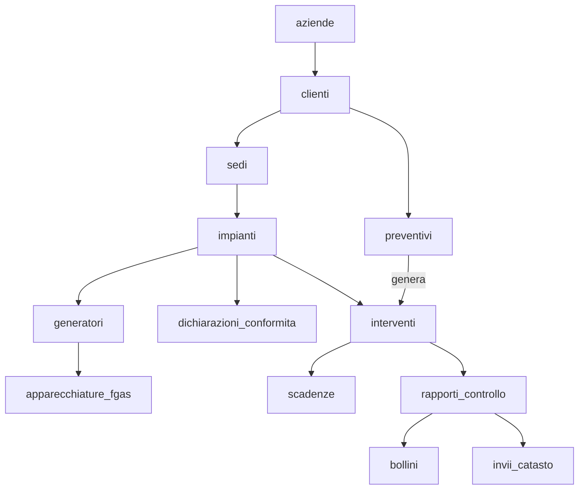

# Piano di sviluppo – Gestionale impianti termici e clima

Versione del 21 novembre 2026. Questo file è l'esportazione del documento di pianificazione. Le decisioni segnate come "deciso" sono confermate; le sezioni "da validare" vanno verificate sui testi ufficiali prima di scrivere codice.

## Visione e perimetro

Il prodotto è un gestionale desktop on-premise per piccole imprese che installano e manutengono caldaie, climatizzatori e pompe di calore: trasforma gli obblighi normativi in scadenze e documenti già pronti.

**Target:** imprese da 1 a 10 persone, con clienti privati, condomini e aziende. Primo adattatore regionale: Toscana (catasto SIERT). Secondo: Lombardia (catasto CURIT).

**Obiettivi (target proposti, da verificare):**

- Creare un rapporto di controllo completo in meno di 3 minuti partendo dalla scheda impianto.
- Non perdere nessuna scadenza: ogni impianto ha sempre una "prossima azione" calcolata.
- Funzionare in rete locale senza internet, con i dati che restano in azienda.
- Servire anche da portfolio: codice, test, CI e documentazione pubblici su GitHub.

**Dentro l'MVP:** anagrafiche, impianti, interventi, scadenze, preventivi, rapporti di controllo e bollini, registro F-Gas, bozza della dichiarazione di conformità, chatbot base.

**Fuori ambito:** invio alla fatturazione elettronica (SDI) e contabilità, magazzino completo, app mobile nativa, firma digitale integrata.

## Utenti e ruoli

Il sistema prevede sei ruoli, pensati su come lavora davvero una piccola impresa: pochi profili, con la firma dei documenti normativi legata a persone precise.

| Ruolo | Chi è | Cosa fa nel sistema |
| --- | --- | --- |
| Titolare | Legale rappresentante | Vede e fa tutto sui dati aziendali; firma come dichiarante le dichiarazioni di conformità |
| Amministrativo | Segreteria, back office | Anagrafiche, preventivi, pianificazione, scadenze e richiami |
| Responsabile tecnico | Tecnico abilitato dell'impresa | Valida rapporti di controllo e dichiarazioni di conformità; firma se diverso dal dichiarante |
| Tecnico | Operatore sul campo | Vede i propri interventi, compila rapportini e rapporti di controllo |
| Sola lettura | Consulente, commercialista | Consulta dati e report, senza modificare nulla |
| Amministratore di sistema | Chi gestisce il server | Utenti, backup, aggiornamenti, configurazione; nessun accesso ai dati di business per impostazione predefinita |

Il ruolo "Responsabile tecnico" esiste perché la dichiarazione di conformità è firmata dal legale rappresentante e dal responsabile tecnico, se sono persone diverse. In un'impresa da una sola persona, un utente può avere più ruoli insieme.

## Funzionalità

L'MVP copre 12 aree, con la compliance come elemento distintivo; il lavoro sul campo arriva in Fase 2 e il pacchetto per il server del cliente in Fase 3.

| Area | Funzionalità | Fase |
| --- | --- | --- |
| Anagrafiche | Clienti (privati, condomini, aziende), più sedi per cliente, contatti, consensi privacy | MVP |
| Impianti | Scheda impianto, generatori multipli, matricola, PDR, dati catastali, foto e documenti, storico | MVP |
| Interventi | Calendario, assegnazione al tecnico, stati, materiali e ore, rapportino PDF | MVP |
| Scadenze | Prossima manutenzione o controllo calcolata per tipo di impianto e cadenza regionale, lista "da richiamare" | MVP |
| Rapporti di controllo | Compilazione guidata con validazione, archivio, file di invio al catasto regionale | MVP |
| Bollini | Registro dei bollini regionali: acquistati, assegnati, usati; controllo contro il doppio uso | MVP |
| F-Gas | Apparecchiature, carica, controlli perdite, registro interventi, dati per la comunicazione alla banca dati | MVP |
| Dichiarazione di conformità | Bozza guidata con allegati e archivio; la firma resta esterna | MVP |
| Preventivi | Listino, righe, numerazione progressiva senza buchi, PDF, conversione in intervento | MVP |
| Importazione | Caricamento da Excel/CSV dei clienti e degli impianti esistenti | MVP |
| Promemoria | Email ai clienti con le scadenze (SMTP configurabile) | MVP |
| Chatbot | Domande sui dati e bozze di testo (base) | MVP |
| Lavoro sul campo | App web installabile (PWA) offline, foto, firma del cliente, lettura codici | Fase 2 |
| Chatbot sui manuali | Ricerca semantica nei PDF dei produttori con citazione della fonte | Fase 2 |
| Report | Fatturato ricorrente, interventi per tecnico, tasso di richiamo | Fase 2 |
| Distribuzione sul server | Installazione guidata, backup con restore testato, aggiornamenti con rollback | Fase 3 |
| Messaggi WhatsApp | Promemoria via WhatsApp Business | Fase 3 |
| Seconda regione | Adattatore Lombardia (CURIT) | Fase 3 |

## Interfaccia e design

L'interfaccia deve sembrare uno strumento di lavoro sobrio e veloce, non un'app di consumo: densità media, uso da tastiera, poche decisioni per schermata e scadenze sempre in primo piano.

**Layout.** Barra laterale sinistra con le aree principali, barra superiore con ricerca globale e utente, area centrale a tabella o scheda, pannello destro per i dettagli e per il chatbot. Ricerca globale e comandi rapidi con Ctrl/Cmd+K.

**Stile.** Palette neutra con un solo colore d'accento (blu petrolio) e colori di stato: rosso per scaduto, ambra per in scadenza, verde per in regola. Lo stato non è mai affidato al solo colore: ci sono sempre icona e testo. Griglia a 8 px, un font leggibile libero da licenze (ad esempio Inter), tema chiaro e scuro.

**Schermate chiave:**

1. **Oggi:** interventi del giorno, scadenze in arrivo, rapporti da trasmettere, bollini in esaurimento.
2. **Scheda cliente:** sedi, impianti, preventivi e storico in un'unica vista.
3. **Scheda impianto:** dati tecnici, generatori, timeline di interventi e documenti, "prossima azione" ben visibile.
4. **Calendario interventi:** vista giorno e settimana per tecnico, trascinamento per riassegnare.
5. **Editor rapporto di controllo:** passi guidati, validazione bloccante prima dell'invio, anteprima del documento.
6. **Registro bollini:** magazzino, assegnazioni, anomalie.
7. **Preventivo:** righe da listino, totali, PDF.
8. **Pannello assistente:** conversazione laterale con le fonti citate.

**Accessibilità.** Contrasto almeno AA, uso completo da tastiera, testo ridimensionabile, messaggi di errore che dicono come correggere. Lingua italiana, testi già predisposti per la traduzione.

**Come ci arriviamo.** Wireframe delle 8 schermate in Penpot (gratuito e open source) prima di scrivere l'interfaccia, poi un design system minimo con colori, spaziature e componenti.

## Login e autenticazione

Ogni utente ha un account personale con password e, per i ruoli più sensibili, un secondo fattore: nessun account condiviso e nessuna credenziale predefinita.

| Tema | Scelta |
| --- | --- |
| Credenziali | Email o nome utente più password; hash con Argon2id; mai password in chiaro né nei log |
| Politica password | Minimo 12 caratteri, controllo contro elenchi di password note, nessuna scadenza periodica forzata |
| Secondo fattore | App TOTP obbligatoria per Titolare e Amministratore di sistema, facoltativa per gli altri; chiavi di sicurezza (WebAuthn) in Fase 3 |
| Sessioni | Token di accesso a vita breve (15 minuti) e token di rinnovo a rotazione, revocabile dal server |
| Memorizzazione sul computer | Token nel portachiavi del sistema (Windows Credential Manager, macOS Keychain), mai in file in chiaro |
| Inattività | Blocco dopo 30 minuti, configurabile; riautenticazione per azioni critiche (firma, cambio ruolo, export) |
| Attacchi | Limite di tentativi e blocco progressivo per account e per indirizzo |
| Recupero accesso | Reset da parte dell'amministratore e codici di recupero per il secondo fattore; la mail non è un requisito in rete locale |
| Primo avvio | Procedura guidata che crea il primo Titolare e il primo Amministratore; nessun utente di default |

L'accesso unico aziendale (SSO con OIDC) resta fuori ambito: per queste imprese è un costo senza beneficio.

## Autorizzazioni

I permessi seguono il principio del minimo privilegio: ogni ruolo è un insieme di permessi granulari, controllati dal server a ogni richiesta e, per i dati più delicati, anche dal database.

Legenda: **L** = lettura, **S** = scrittura (crea e modifica), **F** = firma o validazione, **—** = nessun accesso, **(propri)** = solo le attività assegnate all'utente.

| Funzione | Titolare | Amministrativo | Resp. tecnico | Tecnico | Sola lettura | Admin sistema |
| --- | --- | --- | --- | --- | --- | --- |
| Clienti e sedi | L, S | L, S | L | L (propri) | L | — |
| Anonimizzazione clienti (GDPR, ADR 0004) | S | — | — | — | — | — |
| Impianti e generatori | L, S | L, S | L, S | L, S (propri) | L | — |
| Interventi e calendario | L, S | L, S | L, S | L, S (propri) | L | — |
| Rapporti di controllo | L, S, F | L | L, S, F | L, S (propri) | L | — |
| Dichiarazione di conformità | L, S, F | L | L, S, F | L (propri) | L | — |
| Bollini e invii al catasto | L, S | L, S | L, S | L (propri) | L | — |
| Registro F-Gas | L, S | L | L, S | L, S (propri) | L | — |
| Preventivi | L, S | L, S | L | — | L | — |
| Listino prezzi | L, S | L, S | L | L | — | — |
| Report economici | L | L | — | — | L | — |
| Documenti | L, S | L, S | L, S | L (propri) | L | — |
| Chatbot | S | S | S | S | — | — |
| Utenti e ruoli | L, S | — | — | — | — | L, S |
| Registro attività (audit) | L | — | — | — | — | L |
| Backup, aggiornamenti, configurazione | — | — | — | — | — | L, S |

La matrice è una proposta di partenza: i ruoli sono dati nel database, quindi in Fase 3 si possono personalizzare senza modificare il codice. Il chatbot eredita sempre i permessi di chi lo usa.

## Livelli di sicurezza

Le minacce realistiche per un'impresa di questa dimensione sono furto o smarrimento del computer, ransomware sul server, password deboli, un collaboratore che consulta ciò che non deve e backup mai testati: le difese sono scelte su questi casi, a strati.

| Livello | Misure |
| --- | --- |
| Client desktop | Nessuna credenziale del database nell'app; token nel portachiavi di sistema; aggiornamenti con firma verificata; nessun segreto nel codice |
| Rete | Server non esposto a internet; accesso da fuori solo tramite VPN; TLS anche in rete locale, con certificati interni |
| API | Autorizzazione controllata a ogni richiesta; validazione di tutti gli input; limite di richieste; intestazioni di sicurezza; caricamento file con lista di tipi ammessi, limite di dimensione e rinomina |
| Database | Utenti separati per applicazione, migrazioni e chatbot (sola lettura); privilegi minimi; Row-Level Security sui dati sensibili; autenticazione SCRAM; porta raggiungibile solo dall'API |
| Dati a riposo | Cifratura del disco del server e dei portatili (BitLocker, FileVault, LUKS) richiesta e documentata; backup cifrati |
| Backup | Copia notturna su un secondo supporto, copia esterna cifrata, ripristino provato automaticamente in CI e prima di ogni rilascio |
| Audit | Registro delle attività non modificabile da applicazione: accessi, modifiche ai dati normativi, invii, esportazioni, cambi di ruolo; chi, cosa, quando e da dove |
| Segreti | Variabili d'ambiente o secret di Docker, mai nel repository; scansione dei segreti in CI |
| Filiera software | Aggiornamento automatico delle dipendenze, elenco dei componenti (SBOM), scansione delle immagini dei container in CI |
| Chatbot | Vedi la sezione dedicata |

**Verifica.** Una checklist basata su OWASP ASVS (livello 1) e un'analisi delle minacce di una pagina nel repository: sono segnali concreti di maturità che un recruiter riconosce.

## Chatbot AI locale

L'assistente gira in locale (Ollama), è opzionale e non scrive nulla da solo: risponde sui dati dell'utente, prepara bozze e cita le fonti.

**Casi d'uso:**

- **Domande sui dati (MVP):** "quali impianti hanno il controllo in scadenza nei prossimi 30 giorni?", risolte con funzioni predefinite e non con SQL libero.
- **Bozze (MVP):** promemoria al cliente, descrizione dell'intervento, testo del preventivo.
- **Manuali tecnici (Fase 2):** ricerca semantica nei PDF dei produttori con citazione di documento e pagina.

**Regole di sicurezza:**

- Il chatbot vede solo ciò che l'utente può vedere: eredita il suo ruolo, anche nel database.
- Elenco chiuso di funzioni consentite; utente del database in sola lettura.
- Ogni modifica proposta richiede conferma esplicita dell'utente, con anteprima.
- Il contenuto dei documenti caricati è trattato come dato, mai come istruzione (difesa da prompt injection).
- Richieste e risposte registrate nell'audit; messaggio chiaro che si sta parlando con un'AI.
- Le risposte su normativa riportano sempre la fonte e l'avviso di verificare sul testo ufficiale.

**Hardware.** Un mini PC senza GPU regge male un modello da 8 miliardi di parametri: l'AI resta disattivabile, con modelli più piccoli di default e ricerca semantica come parte più leggera. Le prestazioni vanno misurate in italiano sull'hardware reale prima di promettere tempi.

## Conformità normativa e privacy

Il software produce e archivia documenti con valore legale, quindi ogni regola entra nel prodotto come requisito verificato sul testo ufficiale, mai a memoria. Le fonti qui sotto sono estratti di ricerca, non letture integrali: vanno controllate sugli originali prima di implementare.

| Ambito | Cosa impone al software | Fonte |
| --- | --- | --- |
| F-Gas (DPR 146/2018, Reg. UE 2024/573) | Registro interventi, comunicazione alla banca dati, controlli perdite con frequenze e soglie da verificare per tipo di apparecchiatura | [Camera di Commercio di Firenze](https://www.fi.camcom.gov.it/sites/default/files/uploads/Fgas_webinar_15.10.2025_CCIAA%20FI%20(1).pdf) |
| Dichiarazione di conformità (DM 37/08) | Modello, allegati obbligatori, firma del dichiarante e del responsabile tecnico, invio telematico opzionale | [Camera di Commercio di Basilicata](https://www.basilicata.camcom.it/print/1201) |
| Impianti termici, Toscana (Reg. regionale 25/R/2015, LR 24/2022) | Accatastamento su SIERT, rapporto di controllo con bollino regionale, trasmissione entro 60 giorni, cadenze per tipo di impianto | [SIERT, istruzioni](https://siert.regione.toscana.it/upload/Istruzioni.pdf), [SIERT, cadenze](https://siert.regione.toscana.it/upload/Nota_confronto_2019_2020_revasl.pdf), [LR 24/2022](https://legislazionetecnica.it/node/5191724) |
| Impianti termici, Lombardia (CURIT) | Targa, libretto di impianto, dichiarazione di avvenuta manutenzione registrata via web | [CURIT, istruzioni libretto](https://www.curit.it/documents/22402/1670322/Istruzioni+Libretto+di+impianto/25961faf-b01d-4a0d-a881-fd1f03b264db) |

**Privacy (GDPR).** L'impresa cliente è titolare del trattamento dei dati dei propri clienti; il software deve aiutarla a rispettare:

- minimizzazione dei dati e finalità chiare per ogni campo;
- diritti degli interessati: esportazione e cancellazione o anonimizzazione di un cliente;
- conservazione limitata, con regole configurabili per tipo di documento;
- registro delle attività (audit) e misure di sicurezza documentate;
- nel repository solo dati fittizi, mai dati reali.

**Disclaimer.** Il software è un supporto alla compilazione e non sostituisce la verifica normativa né la responsabilità di chi firma. Va scritto nel README, nelle condizioni d'uso e in ogni documento generato.

## Requisiti non funzionali e qualità

I numeri sono obiettivi di progetto, non misure: si confermano con test su dati di prova realistici.

| Area | Obiettivo |
| --- | --- |
| Dimensione | Fino a 20 utenti contemporanei e 100.000 impianti per installazione |
| Prestazioni | Ricerca globale sotto i 300 ms, apertura di una scheda sotto 1 s, avvio dell'app sotto 3 s |
| Disponibilità | Server in rete locale; perdita massima di dati 24 ore (backup notturno), ripristino in 4 ore |
| Piattaforme | Windows e macOS nelle versioni ancora supportate dai produttori; server Linux |
| Test | Test unitari sul dominio, test di integrazione con database reale, test delle funzioni SQL, qualche test end-to-end sui flussi chiave |
| Qualità del codice | Analisi statica e formattazione automatica in CI; ogni modifica passa da pull request |
| Osservabilità | Log strutturati, controllo di salute del servizio, metriche con OpenTelemetry |
| Manutenibilità | Migrazioni del database versionate, decisioni architetturali scritte (ADR), versioni semantiche |
| Lingua | Italiano; testi estratti in file di traduzione per poter aggiungere altre lingue |
| Documentazione | README con screenshot e demo di 60 secondi, schema ER, guida di installazione, manuale utente breve |

## Stack tecnologico

Lo stack è deciso (19 novembre 2026): desktop in Avalonia 12, backend ASP.NET Core su .NET 10 LTS, database PostgreSQL 18 con pgvector, tutto in C# e SQL.

| Livello | Scelta | Note |
| --- | --- | --- |
| Desktop | Avalonia 12, MVVM con CommunityToolkit.Mvvm | Windows e macOS; framework con licenza MIT |
| Backend | ASP.NET Core su .NET 10 LTS, minimal API REST | .NET 10 è supportato fino al 14 novembre 2028 |
| Accesso ai dati | Npgsql e Dapper, anche per il CRUD semplice | Logica critica nelle funzioni SQL; niente EF Core (ADR 0003, 22 novembre 2026) |
| Database | PostgreSQL 18, pgvector | Row-Level Security, ricerca semantica nello stesso DB |
| Migrazioni | DbUp, script SQL versionati | Nessuna generazione automatica dello schema |
| Autenticazione | Su misura sullo schema sec: Argon2id (Konscious), TOTP (Otp.NET), JWT a vita breve con rinnovo a rotazione | Come da sezione Login; niente ASP.NET Core Identity (ADR 0002, 22 novembre 2026) |
| Documenti e import | QuestPDF, CsvHelper, ClosedXML, MailKit | Verificare la licenza di QuestPDF prima dell'uso |
| AI locale | Ollama, Microsoft.Extensions.AI, embeddings multilingue (bge-m3) | Opzionale e disattivabile |
| Lavoro sul campo (Fase 2) | PWA offline: Blazor WebAssembly oppure React con TypeScript | Decisione aperta, ADR a M7 dopo una prova pratica |
| Test | xUnit, Testcontainers, pgTAP, test end-to-end sui flussi chiave | Postgres reale nei test |
| Server del cliente | Docker Compose: Postgres, API, Caddy per TLS, Ollama opzionale | Volume di Postgres 18 su /var/lib/postgresql |
| Accesso remoto | Tailscale o WireGuard | Nessuna porta aperta |
| Installer e aggiornamenti | Velopack | Senza firma a pagamento compaiono avvisi del sistema operativo |
| CI/CD e sicurezza | GitHub Actions, Dependabot, Trivy, gitleaks | Gratuiti sui repository pubblici |
| Osservabilità | Serilog, OpenTelemetry | Log strutturati e metriche |
| Design | Penpot | Wireframe delle 8 schermate |

**Regole di stack:**

- **Funzioni e procedure:** si usano soprattutto funzioni SQL, che partecipano alle transazioni; le procedure solo quando serve un COMMIT interno.
- **Dipendenze:** ogni libreria si sceglie dopo aver controllato la licenza. Alcune librerie molto usate (ad esempio MediatR e AutoMapper) sono passate a licenza commerciale: niente scorciatoie con dipendenze a rischio.
- **Versioni:** .NET resta sulla LTS; PostgreSQL e pgvector si aggiornano con minor release e prove automatiche in CI.

**Fonti** (estratti consultati il 19 novembre 2026, da riverificare): [politica di supporto .NET](https://dotnet.microsoft.com/platform/support/policy/dotnet-core), [Avalonia, licenza e finanziamento](https://avaloniaui.net/sustainability), [PostgreSQL, versioni e supporto](https://www.postgresql.org/support/versioning).

## Progetto del database

Il database ha sette schemi e 40 tabelle, costruiti attorno a tre idee: ogni dato di business appartiene a un'azienda e lo garantisce il database stesso, le regole normative sono dati con una data di validità, e ciò che ha valore legale non si modifica né si cancella.

**Convenzioni:**

- **Nomi:** `snake_case` in italiano, tabelle al plurale, chiavi esterne `<entità>_id`, vincoli con prefisso `pk_`, `fk_`, `uq_`, `ck_`.
- **Chiavi:** UUID v7 generati dal database (`uuidv7()`, introdotta in PostgreSQL 18), ordinabili nel tempo e adatti agli indici.
- **Tipi:** `timestamptz` per date e ore, `numeric(12,2)` per gli importi, `numeric(5,2)` per le percentuali.
- **Stati:** tabelle di lookup per ciò che è regolato dalla normativa, vincoli `CHECK` per gli stati interni; niente tipi ENUM nativi, scomodi da modificare nelle migrazioni.
- **Colonne comuni:** `azienda_id` su ogni tabella di business, `creato_il`, `creato_da`, `modificato_il`, `modificato_da`, `versione` (concorrenza ottimistica).
- **Cancellazioni:** cancellazione logica solo per l'anagrafica; i documenti normativi non si cancellano, si annullano con uno stato.
- **Regole come dati:** cadenze, tipi e importi dei bollini, modelli di rapporto stanno in tabelle con `valido_dal` e `valido_al`, non nel codice.
- **JSONB:** solo dove il modulo ufficiale cambia per modello e versione (schede del libretto, campi del rapporto di controllo), con validazione contro uno schema JSON nell'API.
- **File:** sul disco del server, in un volume; il database tiene metadati e impronta SHA-256.

### Mappa delle relazioni

Le frecce vanno da una tabella a quelle che ne dipendono; i preventivi accettati generano gli interventi. Ogni tabella di business porta anche `azienda_id`, mentre utenti, documenti e audit si collegano a quasi tutte le altre e non sono disegnati.

### Schema sec: accessi e audit

| Tabella | Contenuto principale | Vincoli e note |
| --- | --- | --- |
| `aziende` | Ragione sociale, partita IVA, codice fiscale, sede, regione di riferimento (sceglie l'adattatore regionale) | È il tenant: ogni tabella di business la referenzia |
| `utenti` | Email, nome, hash Argon2id, stato, MFA (segreto cifrato, attivo), tentativi falliti, blocco fino a | Email unica su tutto il database, perché si accede senza codice azienda (ADR 0002); il segreto MFA non è mai in chiaro |
| `ruoli`, `permessi`, `ruoli_permessi` | I sei ruoli come dati, permessi granulari, assegnazioni | Ruoli e permessi di sistema non cancellabili; in Fase 3 ruoli personalizzabili |
| `utenti_ruoli` | Ruoli di ciascun utente | Un utente può averne più di uno |
| `sessioni_rinnovo` | Hash del token di rinnovo, scadenza, revoca, dispositivo, indirizzo | Token mai in chiaro; rotazione a ogni uso |
| `codici_recupero` | Hash dei codici di recupero del secondo fattore | Monouso |
| `audit_log` | Chi, cosa, quando, da dove, entità e dettaglio in JSONB | Solo inserimento: all'utente del database dell'API sono tolti UPDATE e DELETE; partizionata per mese se serve |
| `parametri_azienda` | Impostazioni: SMTP, numerazioni, soglie dei promemoria | Valori segreti cifrati |

### Schema anagrafica

| Tabella | Contenuto principale | Vincoli e note |
| --- | --- | --- |
| `clienti` | Tipo (privato, condominio, azienda), denominazione o nome e cognome, codice fiscale, partita IVA, PEC | Cancellazione logica; funzione di anonimizzazione per il GDPR |
| `contatti` | Telefoni ed email di ogni cliente | Un solo contatto principale per tipo (indice univoco parziale) |
| `sedi` | Indirizzo, comune, provincia, CAP, note di accesso, coordinate | Più sedi per cliente; indice sull'indirizzo normalizzato |
| `consensi_privacy` | Finalità, concesso sì o no, data, fonte | Storico che non si modifica |

### Schema impianti

| Tabella | Contenuto principale | Vincoli e note |
| --- | --- | --- |
| `tipi_impianto` | Impianto termico, climatizzazione, pompa di calore e simili | Lookup collegato alle regole di cadenza |
| `impianti` | Sede, tipo, stato, anno di installazione, potenza utile, combustibile, PDR, proprietario e responsabile (riferimenti a clienti) | Indice univoco parziale su azienda e PDR per gli impianti attivi; avviso su indirizzo duplicato, come nei controlli del catasto regionale |
| `riferimenti_catasto` | Regione, sistema (SIERT o CURIT), codice catasto o targa, data di registrazione | Unico per regione e codice |
| `generatori` | Impianto, tipo, marca, modello, matricola, potenza, combustibile, date di installazione e dismissione | Più generatori per impianto; avviso su matricola duplicata |
| `libretti` | Impianto, versione, modello normativo, data, firmatario | Versionato, mai sovrascritto |
| `libretto_schede` | Numero della scheda e contenuto in JSONB | Validato contro lo schema del modello |

### Schema lavoro

| Tabella | Contenuto principale | Vincoli e note |
| --- | --- | --- |
| `interventi` | Numero, impianto, tipo, stato, finestra pianificata (intervallo di tempo), tecnico, esito, note, chiusura | Vincolo di esclusione GiST: un tecnico non ha interventi sovrapposti; numero da funzione |
| `interventi_righe` | Materiali e manodopera con quantità, ore e prezzi | Prezzi copiati dal listino al momento, per uno storico fedele |
| `scadenze` | Impianto o generatore, tipo, data, stato, regola applicata, intervento di origine e di chiusura, stato del richiamo | Indice su azienda e data per le scadenze aperte; ricalcolate alla chiusura dell'intervento |
| `richiami` | Tentativi di contatto: canale, data, esito | Alimenta il tasso di richiamo |

### Schema norma: compliance

| Tabella | Contenuto principale | Vincoli e note |
| --- | --- | --- |
| `regole_cadenza` | Regione, tipo di impianto, condizioni (potenza, combustibile, gas), periodicità, primo controllo, riferimento normativo | Valide dal e al: sono dati, non codice |
| `tipi_bollino` | Regione, nome, importo, validità, condizioni di potenza | Importi da verificare sul sito regionale |
| `bollini` | Codice, tipo, stato (disponibile, assegnato, usato, annullato), acquisto, rapporto assegnato | Codice univoco; un bollino usato ha sempre un rapporto; assegnazione atomica con blocco di riga |
| `rapporti_controllo` | Impianto, generatore, intervento, modello, data del controllo, esito, dati in JSONB, stato (bozza, validato, firmato, trasmesso, scartato), bollino | Termine di trasmissione calcolato dalla regola regionale (in Toscana 60 giorni); dopo la firma un trigger blocca ogni modifica ai dati |
| `invii_catasto` | Regione, sistema, tipo di comunicazione, oggetto, file generato, stato, ricevuta, errore, tentativi | Una comunicazione per oggetto e versione: i reinvii non creano doppioni |
| `dichiarazioni_conformita` | Numero progressivo, impianto, intervento, dichiarante, responsabile tecnico, tipologia, stato, documento PDF | Numerazione per azienda e anno; immutabile dopo la firma |
| `dico_allegati` | Tipo di allegato, presente sì o no, documento collegato | Elenco degli allegati obbligatori da confermare sul testo del DM 37/08 |
| `apparecchiature_fgas` | Generatore, gas, GWP, carica in kg, CO₂ equivalente, ermeticamente sigillata, rilevatore di perdite | CO₂ equivalente = carica × GWP / 1000, in tonnellate, colonna calcolata |
| `interventi_fgas` | Apparecchiatura, intervento, tipo (installazione, controllo perdite, manutenzione, riparazione, recupero, smantellamento), gas aggiunto e recuperato, perdite, operatore certificato, protocollo | Alimenta il registro e la comunicazione alla banca dati F-Gas |
| `certificazioni` | Persona o impresa, tipo, numero, ente, scadenza | Impedisce di assegnare interventi F-Gas a chi non ha una certificazione in corso di validità |

### Schema commerciale

| Tabella | Contenuto principale | Vincoli e note |
| --- | --- | --- |
| `listino_voci` | Codice, descrizione, tipo (materiale o manodopera), unità, prezzo, IVA, attiva | Codice unico per azienda; storico dei prezzi separato |
| `preventivi` | Anno, numero, cliente, sede, impianto, stato, validità, totali, intervento generato | Unico su azienda, anno e numero |
| `preventivi_righe` | Riga, voce, descrizione, quantità, prezzo, sconto, IVA | Totali ricalcolati da funzione; righe modificabili solo in bozza |
| `contatori` | Azienda, tipo di documento, anno, ultimo numero | Aggiornato con `INSERT ... ON CONFLICT DO UPDATE` nella stessa transazione del documento: se la transazione fallisce il numero non si perde |

### Schema documenti

| Tabella | Contenuto principale | Vincoli e note |
| --- | --- | --- |
| `documenti` | Nome, tipo MIME, dimensione, SHA-256, percorso su disco, categoria, entità collegata, versione | Collegamento con tipo e id di entità, quindi integrità controllata da funzione; i documenti normativi non si cancellano |
| `documenti_chunk` | Pagina, testo, vettore di embedding, indice di ricerca testuale | HNSW sul vettore e GIN sul testo, sempre filtrati per azienda; la dimensione del vettore dipende dal modello scelto |

### Funzioni SQL

La logica transazionale vive in funzioni, chiamate da Dapper; ognuna ha test pgTAP.

| Funzione | Cosa fa |
| --- | --- |
| `prossimo_numero(azienda, tipo, anno)` | Restituisce il numero successivo in modo atomico e senza buchi |
| `assegna_bollino(rapporto)` | Sceglie e blocca un bollino disponibile del tipo giusto (`FOR UPDATE SKIP LOCKED`) |
| `valida_rapporto(rapporto)` | Elenca gli errori che bloccherebbero l'invio: campi mancanti, bollino non coerente, termine superato |
| `chiudi_intervento(intervento, esito, righe)` | In una transazione: stato, righe, scadenza chiusa, prossima scadenza calcolata, bozza del rapporto se previsto |
| `ricalcola_scadenze(impianto)` | Applica le regole di cadenza valide per regione, tipo e potenza |
| `scadenze_in_arrivo(giorni)` | Lista dei richiami da fare; usata anche dal chatbot |
| `report_fatturato(...)`, `report_interventi_tecnico(...)` | Aggregati per il cruscotto |
| `anonimizza_cliente(cliente)` | Anonimizza i dati personali mantenendo i documenti con valore legale |

### Sicurezza nel database

- **Tre ruoli del database:** `app_owner` (migrazioni), `app_api` (runtime, soggetto a RLS, senza `BYPASSRLS`), `app_chatbot` (sola lettura, solo viste `v_chatbot_*`).
- **Row-Level Security:** ogni tabella con `azienda_id` ha una policy `azienda_id = current_setting('app.azienda_id')::uuid`; l'API imposta il valore con `SET LOCAL` a inizio transazione, attenzione al pooling di Npgsql.
- **Restrizioni «solo propri»:** applicate dall'API; la RLS per azienda è la rete di sicurezza sotto.
- **Audit:** trigger su `rapporti_controllo`, `bollini`, `invii_catasto`, `dichiarazioni_conformita`, `interventi_fgas` e `utenti_ruoli`, oltre agli eventi dell'API.
- **Test pgTAP obbligatori:** isolamento tra aziende, numerazione sotto concorrenza, doppia assegnazione di un bollino, immutabilità dopo la firma.

### Da validare prima di scrivere le migrazioni

- Campi esatti dei rapporti di controllo e tracciato di invio SIERT nella versione corrente.
- Tipi e importi dei bollini regionali.
- Elenco degli allegati obbligatori della dichiarazione di conformità.
- Dimensione del vettore di embedding del modello scelto.
- Un solo tecnico per intervento oppure una squadra: per l'MVP il tecnico è uno, con possibile tabella dei collaboratori in seguito.
- Partizionamento di `audit_log`: rimandato finché i volumi non lo richiedono.

## Piano di sviluppo a milestone

L'MVP richiede circa 20 settimane a tempo parziale (da M0 a M6); Fase 2, Fase 3 e la seconda regione ne aggiungono altre 11. Le durate sono stime e dipendono dall'esperienza con lo stack scelto. Le date partono da lunedì 23 novembre 2026.

| Milestone | Contenuto | Settimane | Periodo |
| --- | --- | --- | --- |
| M0 | Fondamenta: repository, CI, docker-compose, schema base | 1 | 23 nov – 30 nov 2026 |
| M1 | Accessi e anagrafiche | 3 | 30 nov – 21 dic 2026 |
| M2 | Impianti e interventi | 4 | 21 dic 2026 – 18 gen 2027 |
| M3 | Scadenze e preventivi | 3 | 18 gen – 8 feb 2027 |
| M4 | Compliance Toscana | 4 | 8 feb – 8 mar 2027 |
| M5 | Chatbot base | 3 | 8 mar – 29 mar 2027 |
| M6 | Rilascio MVP | 2 | 29 mar – 12 apr 2027 |
| MVP pronto | | | 12 apr 2027 |
| Fase 2 | Campo e manuali | 5 | 12 apr – 17 mag 2027 |
| Fase 3 | Server del cliente | 3 | 17 mag – 7 giu 2027 |
| Fase 3 | Adattatore Lombardia | 3 | 7 giu – 28 giu 2027 |

**Criteri di uscita:**

- **M1:** login con secondo fattore e ruoli funzionanti, con test automatici.
- **M4:** un rapporto di controllo completo, con bollino e file di invio, generato e validato contro la specifica SIERT.
- **M6:** installazione pulita su Windows e macOS contro un server di prova, ripristino da backup verificato, README e demo pronti.

## Rischi e decisioni aperte

Il rischio principale è costruire su regole copiate da documenti datati e senza un utente reale che le confermi; il resto si gestisce con perimetro chiaro e scelte reversibili.

| Rischio o decisione | Perché conta | Cosa facciamo |
| --- | --- | --- |
| Tracciato di invio SIERT e regole regionali datati | I documenti trovati sono del 2018 e del 2023 | Scaricare le specifiche correnti dal portale e testare con dati fittizi |
| Nessun utente reale con cui validare | Il dominio potrebbe avere casi che non conosciamo | Modello dati ricavato dai moduli ufficiali; README che dichiara che non è validato sul campo |
| Ampliamento del perimetro (fatturazione, magazzino) | Sono pozzi senza fondo | Restano fuori ambito, scritto nel piano |
| Responsabilità sui documenti generati | Hanno valore legale | Disclaimer; firma sempre esterna e a carico dell'utente |
| Hardware del cliente troppo debole per il chatbot | Esperienza lenta | AI opzionale, modelli piccoli, test su hardware reale |
| Licenza del repository | Decide se il codice si può riutilizzare o vendere | Deciso il 20 novembre 2026: MIT, perché l'obiettivo attuale è il portfolio. Se si deciderà di vendere, si ristruttura il codice e le versioni future cambiano licenza; quelle già pubblicate restano MIT |
| Scelta dello stack | Condiziona tempi e competenze mostrate | **Deciso** il 19 novembre 2026: Avalonia 12, .NET 10 LTS e PostgreSQL 18, vedi la sezione Stack tecnologico |
| Firma digitale dei documenti | Costosa e complessa | Decisione aperta: solo PDF da firmare fuori dal sistema, o integrazione in seguito |
| Altre regioni | Ogni regione ha il proprio catasto | Interfaccia comune e un adattatore per regione; Toscana per prima, Lombardia seconda |
